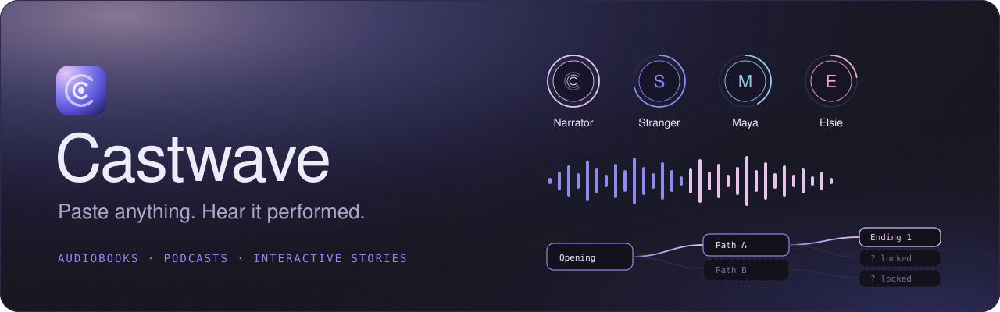
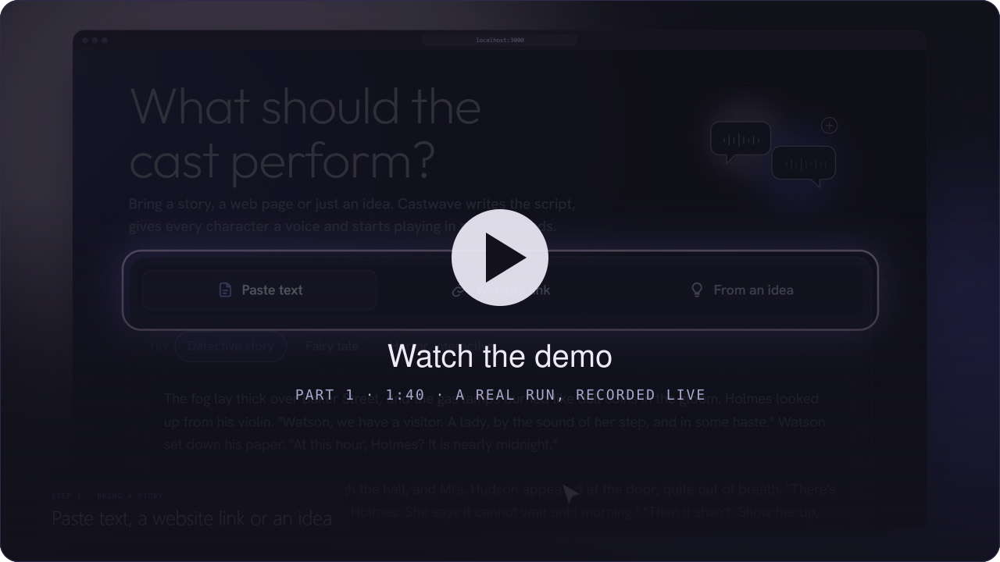
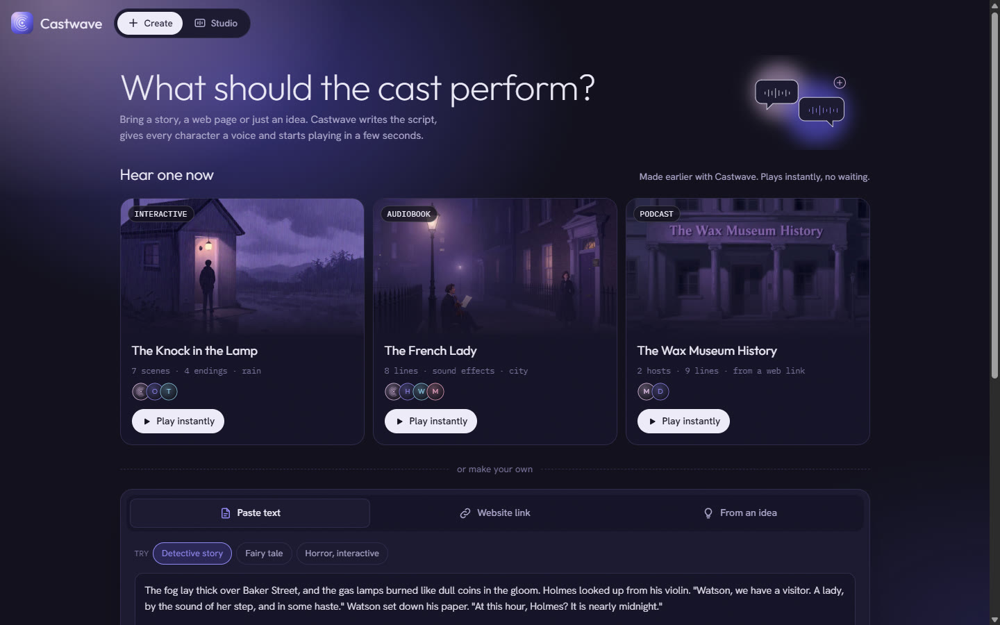
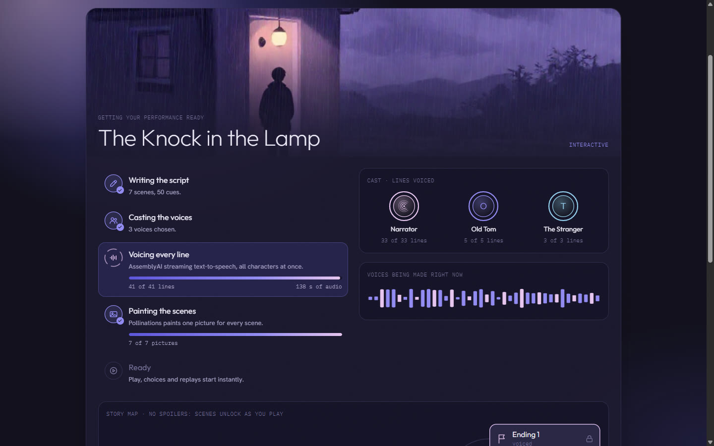
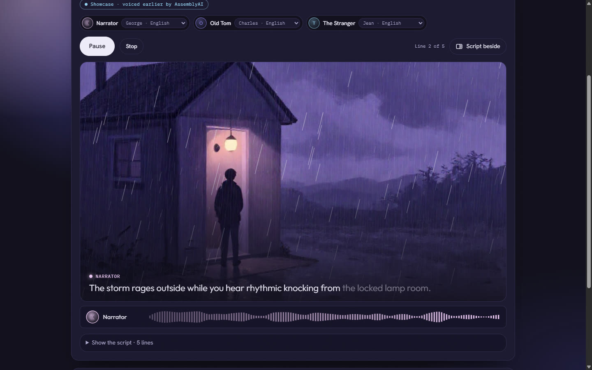
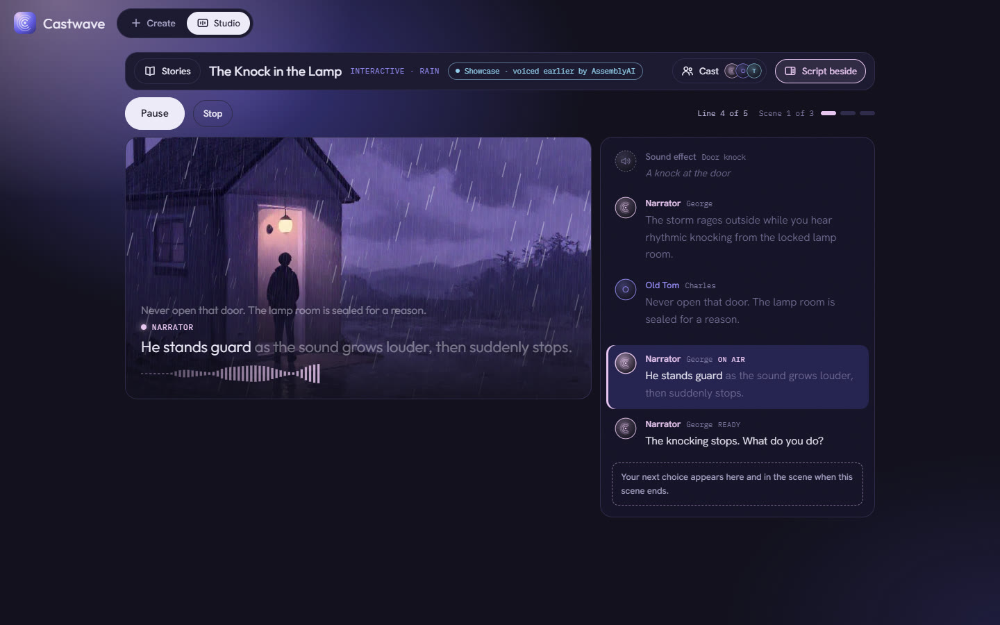
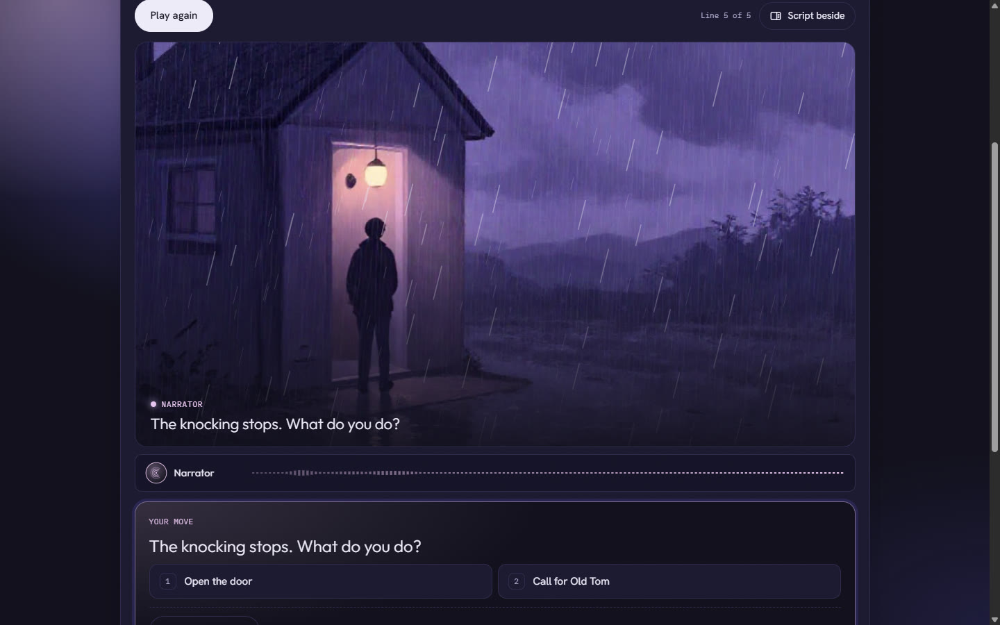
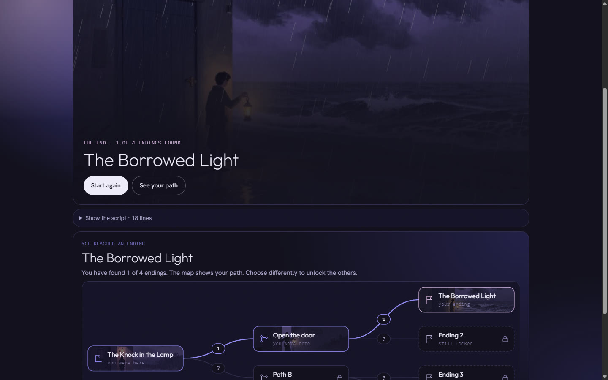
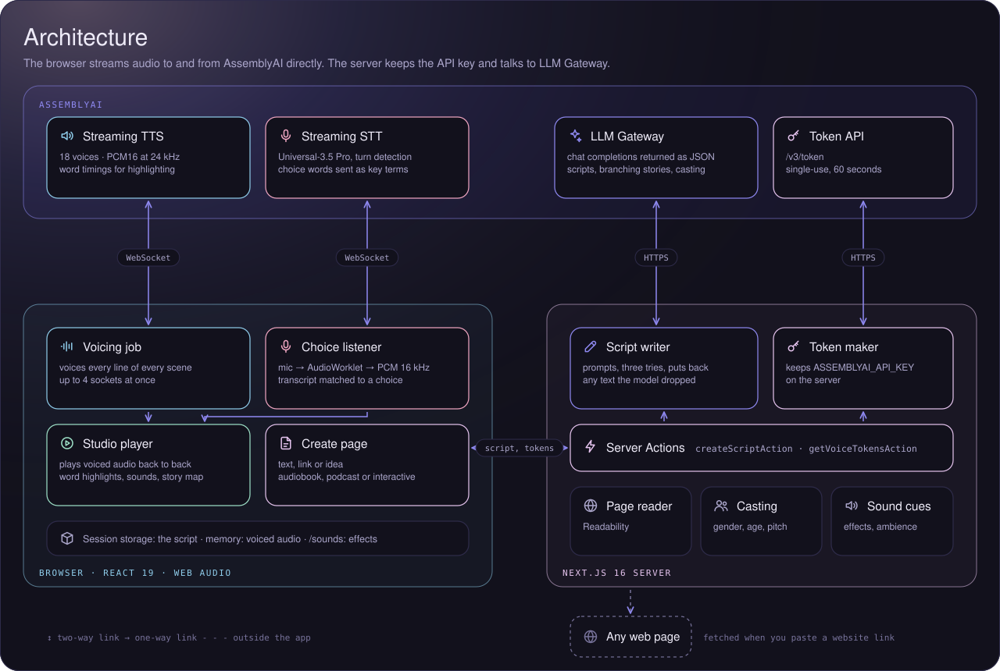

<p align="center"></p>

<p align="center">
  <strong>Paste anything. Hear it performed.</strong><br>
  A story, a web page or an idea becomes an audiobook, a two-host podcast or an interactive story,<br>
  with a voice for every character, a picture for every scene and choices you can speak out loud.
</p>

<p align="center">
  Built for the AssemblyAI Text-to-Speech hackathon, October 15–23, 2026.
</p>

##  Try it

1. Run Castwave (see Local setup below) and open it in Chrome.
2. Under **Hear one now**, click any story. It plays at once: these three were made earlier with the real pipeline and saved with the app, so they need no waiting and no API credit.
3. Below the shelf, make your own from pasted text, a website link or a one-line idea. Pick **Interactive** to get choices and four endings.
4. At a choice, press **Say your choice** and speak. Your browser will ask for microphone access the first time.

##  Demo video

<p align="center">
  <a href="docs/demo/castwave-demo-part-1.mp4"></a>
</p>

Part 1 (1:40) follows one real run from an idea to a fully voiced, painted story. Every voice inside the app is AssemblyAI; the narrator of the video is Kokoro, a free open-source voice.

##  Screenshots

<table>
  <tr>
    <td width="50%"><br><sub><b>Create.</b> Three ready-made stories, then your own text, link or idea.</sub></td>
    <td width="50%"><br><sub><b>Preparing.</b> Writing, casting, voicing and painting, with the opening scene as the cover.</sub></td>
  </tr>
  <tr>
    <td><br><sub><b>Studio.</b> Captions inside the scene, word by word, with rain on a rainy night.</sub></td>
    <td><br><sub><b>Script beside.</b> One button opens the script next to the scene; it follows the spoken line.</sub></td>
  </tr>
  <tr>
    <td><br><sub><b>Your move.</b> Click, press 1 or 2, or say your choice out loud.</sub></td>
    <td><br><sub><b>The ending.</b> The map reveals the path you took, with the pictures of the scenes you reached.</sub></td>
  </tr>
</table>

##  Features

<table>
  <tr>
    <td width="56"></td>
    <td><strong>Three ways in</strong><br>Paste text, drop in a website link (the article is pulled out with Readability), or type a one-line idea.</td>
  </tr>
  <tr>
    <td></td>
    <td><strong>Three formats</strong><br>A full-cast audiobook that keeps the author's words, a two-host podcast, or an interactive story with two choices and four endings.</td>
  </tr>
  <tr>
    <td></td>
    <td><strong>A voice for every character</strong><br>LLM Gateway works out each character's gender and age, and Castwave picks a matching voice from 18, sorted by their measured pitch. Change any voice and only that character is voiced again.</td>
  </tr>
  <tr>
    <td></td>
    <td><strong>Everything voiced up front</strong><br>A preparing screen voices every line of every scene and branch, up to four voices at once. "Play now" appears as soon as the opening is ready.</td>
  </tr>
  <tr>
    <td></td>
    <td><strong>A picture for every scene</strong><br>While the voices are made, Pollinations paints one picture per scene in the same house style. The opening becomes the cover; the rest play behind each scene.</td>
  </tr>
  <tr>
    <td></td>
    <td><strong>Captions inside the scene</strong><br>The spoken line sits on the picture, lighting up word by word from AssemblyAI's word timings, with the speaker's name in their colour. Nothing to scroll; the script folds away, or opens beside the scene with one button.</td>
  </tr>
  <tr>
    <td></td>
    <td><strong>A stage that reacts</strong><br>Rain falls over rainy stories. The picture flashes on thunder, shakes on a door slam and pulses with a heartbeat, and a waveform follows the real AssemblyAI audio.</td>
  </tr>
  <tr>
    <td></td>
    <td><strong>A story map with no spoilers</strong><br>Scenes stay locked until you reach them. After an ending, the map shows the path you took and how many endings you have found.</td>
  </tr>
  <tr>
    <td></td>
    <td><strong>Spoken choices</strong><br>Say "turn around and leave" or "the second one". AssemblyAI streaming speech-to-text hears it, and the story branches.</td>
  </tr>
  <tr>
    <td></td>
    <td><strong>Sound effects and ambience</strong><br>Knocks, footsteps and thunder play where the narration mentions them, over rain, wind or city ambience picked from the setting.</td>
  </tr>
  <tr>
    <td></td>
    <td><strong>Showcase stories</strong><br>Three stories made with the real pipeline and saved with the app. They play instantly, use no API credit, and are labelled "voiced earlier by AssemblyAI".</td>
  </tr>
</table>

##  Architecture

<p align="center"></p>

| Part | What it does |
|---|---|
| **Create page** | Sends the text, link or idea and the format to a Server Action. |
| **Script writer** | Asks LLM Gateway for a script as JSON: scenes, speakers and cues. Retries up to three times, puts back any text the model dropped, and turns single-quoted dialogue into double-quoted dialogue first. For interactive stories it plans the outline, then writes the scenes four at a time. |
| **Casting** | Asks LLM Gateway for each character's gender and age, then picks a matching unused voice. |
| **Token maker** | Makes a single-use token for each socket, so the API key never reaches the browser. |
| **Voicing job** | Opens one streaming text-to-speech socket per voice, at most four at once, and voices every line. If AssemblyAI reports too many sessions, it waits and retries with a fresh token. |
| **Pictures** | One Server Action paints every scene at once with Pollinations Z-Image Turbo, using a prompt built from the scene, the setting and a fixed house style. |
| **Studio player** | Schedules the voiced audio back to back with Web Audio, with captions inside the scene, sound effects, ambience, rain and cue effects. An `AnalyserNode` drives the live waveform. |
| **Choice listener** | Streams the microphone through an AudioWorklet to streaming speech-to-text, with the choice words sent as key terms, and matches the finished turn to a choice. |
| **Showcase stories** | Saved in `public/showcase/`: the script, every voiced line as a small audio file with its word timings, and the pictures. They load into the same player, so every feature works. |

### How it flows

1. **Bring a story.** You paste text, a link or an idea and pick a format.
2. **Write the script.** LLM Gateway returns scenes and lines. Sound cues and an ambience are added from the text.
3. **Cast the voices.** Each character gets a voice that fits their gender and age.
4. **Voice and paint.** The browser voices the whole story, every branch included, while the server paints a picture for each scene.
5. **Play.** Every line is already voiced, so nothing waits on the network. The captions, picture and effects follow the audio.
6. **Speak a choice.** Your answer is transcribed live and the matching scene plays at once.

### AssemblyAI products used

| Product | Used for |
|---|---|
| Streaming text-to-speech | every spoken line, with word timings for captions and highlighting |
| LLM Gateway | writing scripts, planning branching stories and describing characters for casting |
| Streaming speech-to-text | spoken choices, with key terms for better accuracy |
| Temporary tokens | single-use browser tokens for both streaming services |

Pictures come from [Pollinations](https://pollinations.ai) (Z-Image Turbo). They are optional: without a key, scenes use a soft gradient backdrop.

##  Tech stack

| Area | Tools |
|---|---|
| Framework | Next.js 16 (App Router, Server Actions), React 19 |
| Language | TypeScript 7 in strict mode |
| Validation | zod 4 for every outside reply: LLM output, socket events, saved stories and stored scripts |
| Audio | Web Audio API, AnalyserNode, AudioWorklet, WebSockets |
| Pictures | Pollinations image API (Z-Image Turbo) |
| Web pages | Mozilla Readability and linkedom |
| Styling | CSS Modules, one theme file, and the fonts Outfit, Hanken Grotesk and IBM Plex Mono via `next/font` |
| Tests | Node's built-in test runner |

##  Local setup

**You need:** Node.js 20.9 or newer and an AssemblyAI API key from the [AssemblyAI dashboard](https://www.assemblyai.com/dashboard). A Pollinations key from [enter.pollinations.ai](https://enter.pollinations.ai/keys) is optional.

```bash
git clone https://github.com/FlemingJohn/castwave.git
cd castwave
npm install
cp .env.example .env.local
```

Open `.env.local` and add your keys:

```bash
ASSEMBLYAI_API_KEY=your-assemblyai-key
POLLINATIONS_API_KEY=your-pollinations-key   # optional, for scene pictures
```

Then start the app and open http://localhost:3000:

```bash
npm run dev
```

| Command | What it does |
|---|---|
| `npm run dev` | starts the app on port 3000 |
| `npm run build` | builds the app for production |
| `npm start` | runs the production build |
| `npm run typecheck` | checks the types |
| `npm test` | runs the unit tests |

Spoken choices need microphone access, which browsers only allow on `localhost` or over HTTPS.

##  Known limits

- Writing a new interactive story takes about a minute on the free LLM Gateway model. The showcase stories are there so nobody has to wait for a first impression.
- Scene pictures depend on Pollinations credit. When it runs out, scenes fall back to the gradient backdrop and everything else works.
- AssemblyAI allows about five voice sessions at once per account. Castwave voices four voices at a time and waits and retries if another tab is using sessions.
- Reloading the Studio voices a new story again, because the audio is kept in memory rather than saved.

##  Credits

- Voices, transcription and script writing by [AssemblyAI](https://www.assemblyai.com).
- Scene pictures by [Pollinations](https://pollinations.ai).
- Sound effects from Wikimedia Commons, listed with their licenses in [`public/sounds/CREDITS.md`](public/sounds/CREDITS.md).
- Demo video narration by [Kokoro](https://huggingface.co/hexgrad/Kokoro-82M), an open-source text-to-speech model.

##  License

Castwave is released under the [MIT License](LICENSE). The sound effects in `public/sounds/` keep their own licenses, which are listed in [`public/sounds/CREDITS.md`](public/sounds/CREDITS.md).
